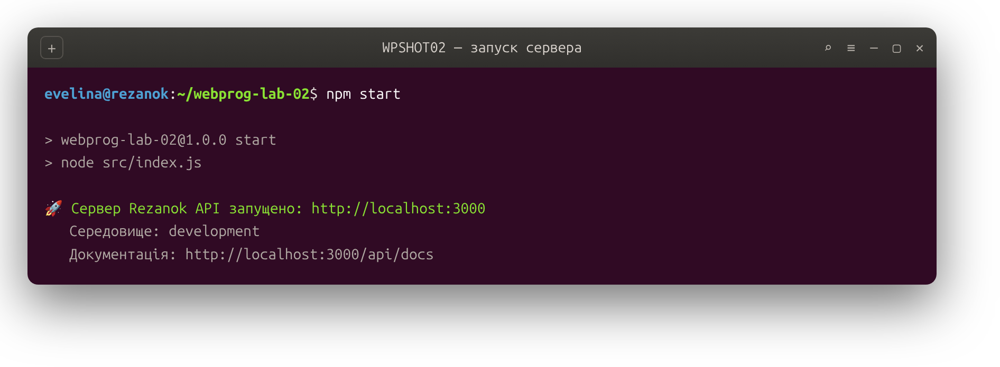
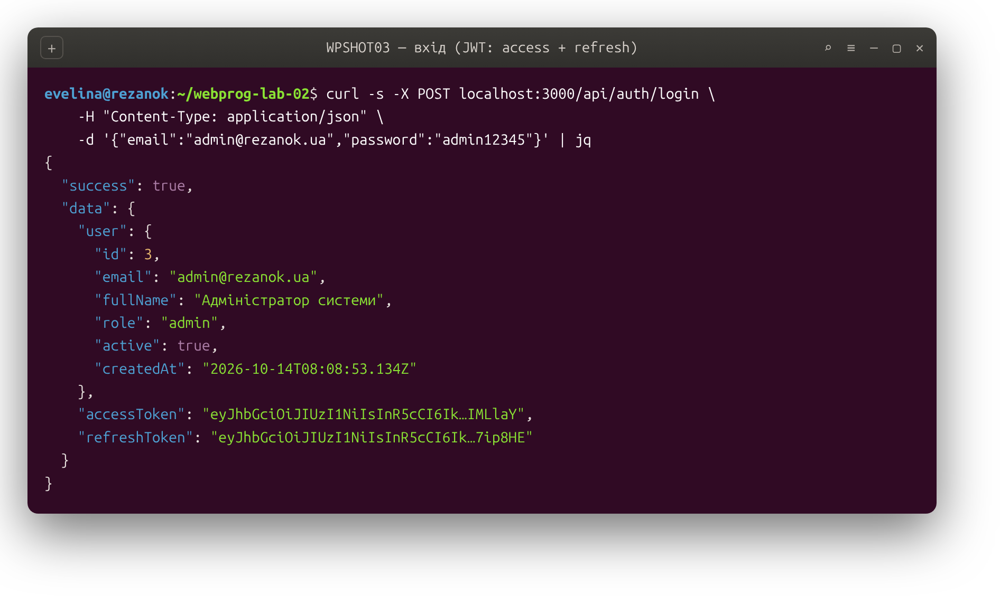
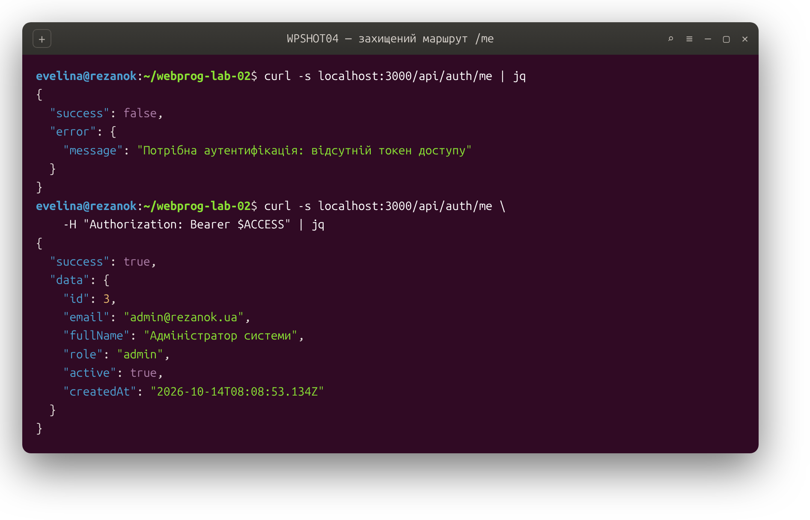
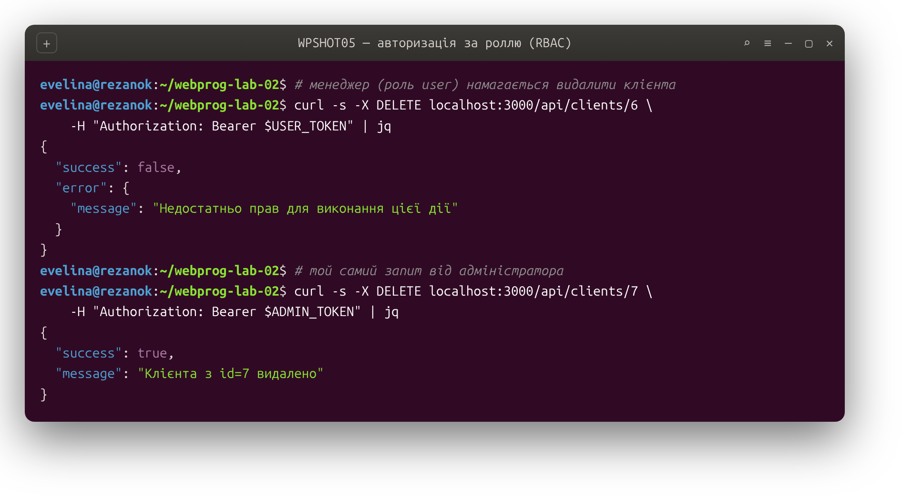
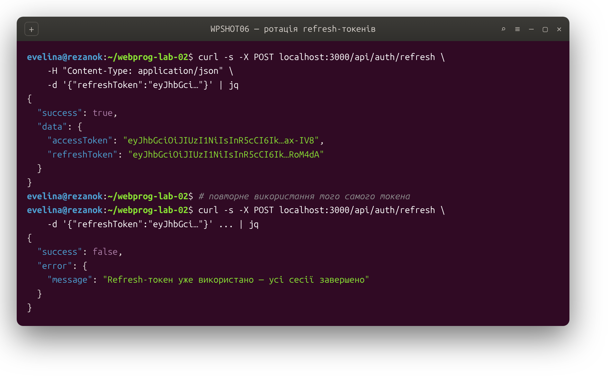
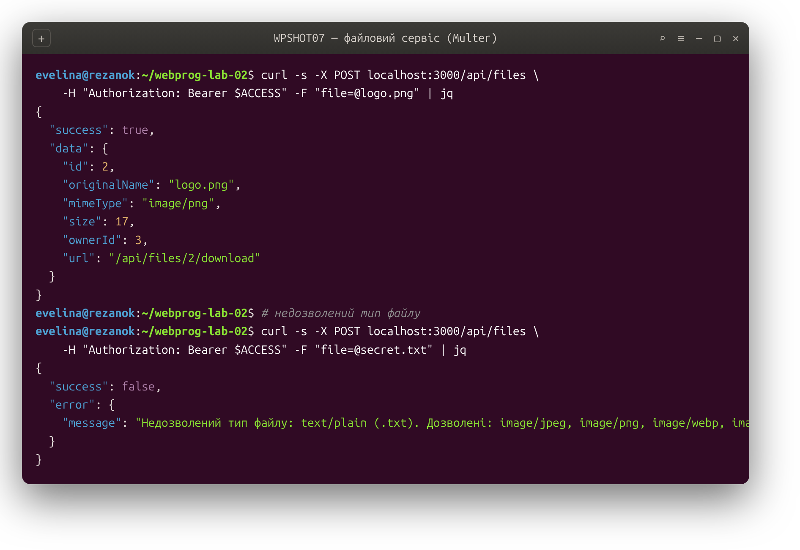
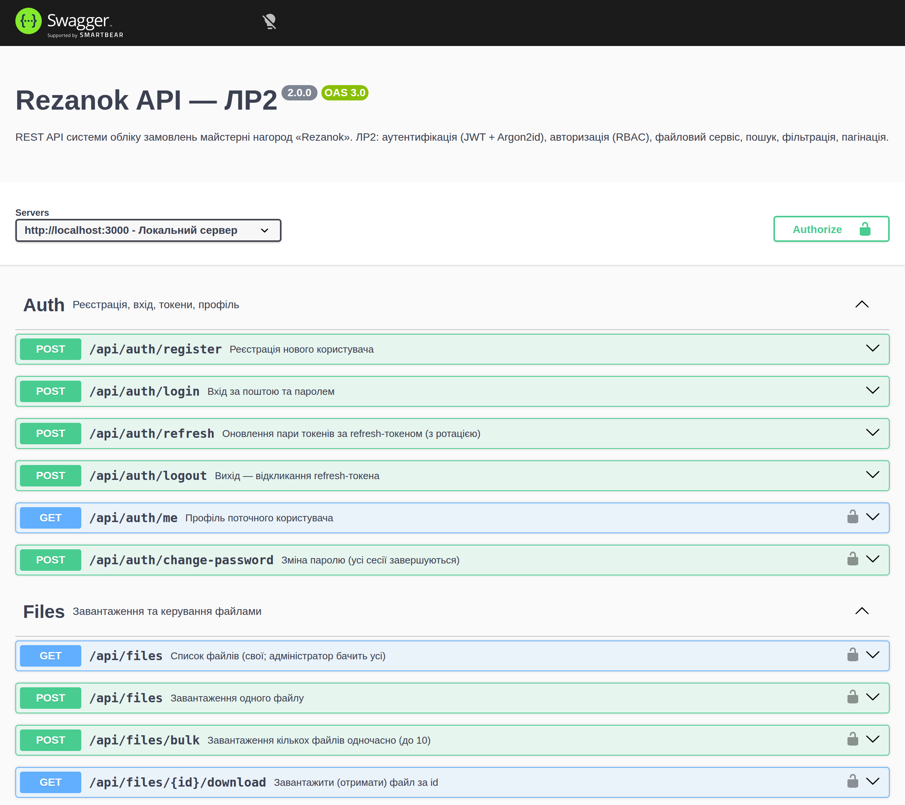

# Rezanok API — аутентифікація, авторизація та розширений функціонал

**Лабораторна робота №2 з дисципліни «Вебпрограмування»**
Виконала: Ткачук Евеліна

Продовження серверної частини системи обліку замовлень майстерні нагород **Rezanok**, розпочатої в лабораторній роботі №1. У цій роботі базовий REST API доповнено повноцінною системою аутентифікації та авторизації користувачів, безпечним зберіганням паролів, файловим сервісом, пошуком і фільтрацією даних та інтерактивною документацією API. Стек залишено тим самим, що й у першій роботі: Node.js + Express + Prisma + PostgreSQL.

---

## 1. Мета та завдання роботи

Метою роботи є набуття практичних навичок реалізації систем аутентифікації та авторизації користувачів у серверному вебзастосунку, впровадження безпечного зберігання паролів і управління сесіями через токени, а також розширення функціональності бекенду файловим сервісом, пошуком, фільтрацією та пагінацією з документуванням API.

Якщо перша робота відповідала на питання «як обслуговувати дані», то друга відповідає на питання «хто й що має право з цими даними робити». До наявного API додано рівень безпеки: тепер доступ до даних майстерні відкрито лише автентифікованим користувачам, а найчутливіші операції — лише адміністраторам. Паролі ніколи не зберігаються у відкритому вигляді, а сесії керуються парою короткоживучого та довгоживучого токенів із можливістю відкликання.

## 2. Що додано порівняно з ЛР1

Перша робота давала відкритий REST API для дев'яти сутностей предметної області. Друга добудовує над ним рівень безпеки та сервісні можливості, не змінюючи стек: реєстрацію та вхід користувачів, хешування паролів алгоритмом Argon2id, видачу та перевірку JWT-токенів, middleware аутентифікації й авторизації за ролями, захист наявних маршрутів, файловий сервіс із валідацією, розширений пошук і фільтрацію, обмеження частоти запитів, журнал дій користувачів, інтерактивну документацію Swagger та набір автоматичних тестів. Нижче кожен із цих блоків описано детально.

## 3. Технології

Серверна частина, як і раніше, написана на **Node.js** із фреймворком **Express 4**, доступ до **PostgreSQL 16** реалізовано через ORM **Prisma 5**, валідацію виконує **Zod**, безпекові заголовки додає **Helmet**, а логування — **morgan**. До цього набору у другій роботі додано кілька спеціалізованих бібліотек.

| Бібліотека | Призначення |
|---|---|
| `jsonwebtoken` | Створення та перевірка JWT-токенів доступу й оновлення |
| `argon2` | Хешування паролів алгоритмом Argon2id (переможець Password Hashing Competition) |
| `multer` (v2) | Обробка `multipart/form-data` та завантаження файлів |
| `swagger-jsdoc` + `swagger-ui-express` | Генерація специфікації OpenAPI з коментарів і її інтерактивний перегляд |
| `express-rate-limit` | Обмеження частоти запитів для захисту від перебору |
| `supertest` | Тестування HTTP-endpoints (разом із вбудованим `node:test`) |

## 4. Архітектура застосунку

Шарова організація коду з ЛР1 збережена, а для нових можливостей додано окремий каталог `middleware/` та відповідні контролери, маршрути й утиліти.

```
webprog-lab-02/
├── prisma/
│   ├── schema.prisma      модель даних: домен ЛР1 + користувачі, токени, файли
│   ├── migrations/        SQL-міграції (зокрема add-auth-and-files)
│   └── seed.js            демо-дані домену + два користувачі (admin, user)
├── src/
│   ├── config/
│   │   ├── env.js         читання та перевірка змінних середовища
│   │   └── swagger.js     конфігурація OpenAPI
│   ├── middleware/
│   │   ├── auth.js        перевірка access-токена (аутентифікація)
│   │   ├── authorize.js   перевірка ролі (авторизація, RBAC)
│   │   ├── upload.js      налаштування Multer із валідацією файлів
│   │   └── rateLimit.js   обмеження частоти запитів
│   ├── controllers/       обробники (додано authController, fileController)
│   ├── routes/            маршрути (додано authRoutes, fileRoutes)
│   ├── validators/        Zod-схеми (додано auth.validator)
│   ├── utils/             помічники (додано jwt, password, activityLog)
│   ├── app.js             складання застосунку, Swagger UI, rate limiting
│   └── index.js           запуск HTTP-сервера
├── tests/auth.test.js     тести endpoints аутентифікації та захисту
├── uploads/               завантажені файли (поза репозиторієм)
└── docker-compose.yml     контейнер PostgreSQL
```

Запит на захищений ресурс проходить передбачуваним ланцюжком: після безпекових middleware і парсерів тіла спрацьовує `authenticate`, який дістає токен із заголовка `Authorization`, перевіряє його підпис і підвантажує користувача з бази у `req.user`; за потреби далі стоїть `authorize('admin')`, що пропускає лише адміністраторів; потім, як і раніше, валідація Zod-схемою й контролер. Будь-яка помилка на цьому шляху збігається в єдиний обробник, який тепер розрізняє ще й помилки аутентифікації (`401`), доступу (`403`) та завантаження файлів.

## 5. Модель даних

До дев'яти таблиць предметної області з ЛР1 додано чотири нові, що обслуговують аутентифікацію та файли.

| Модель | Таблиця | Призначення |
|---|---|---|
| `User` | `users` | Користувач системи: пошта, хеш паролю, роль, статус |
| `RefreshToken` | `refresh_tokens` | Хеш refresh-токена з можливістю відкликання та ротації |
| `File` | `files` | Метадані завантаженого файлу та його власник |
| `ActivityLog` | `activity_logs` | Журнал дій користувачів (хто, що, коли) |

Роль користувача описано окремим переліком `UserRole` (`user` або `admin`). Важливо, що це не те саме, що `EmployeeRole` з першої роботи: `EmployeeRole` описує виробничу роль працівника майстерні (менеджер, дизайнер, виробництво), тоді як `UserRole` визначає рівень доступу до API. Один користувач може мати багато refresh-токенів (різні пристрої чи сесії — зв'язок 1:N) та завантажувати багато файлів (1:N). Refresh-токени й файли видаляються каскадно разом із користувачем, а в журналі дій посилання на користувача при його видаленні лише обнуляється (`SetNull`), щоб зберегти історію.

Ключове рішення щодо безпеки закладено вже на рівні схеми: у таблиці `users` зберігається поле `password_hash`, а не пароль, а в таблиці `refresh_tokens` — поле `token_hash`, а не сам токен. Навіть за повного витоку бази зловмисник не отримає ані робочих паролів, ані дійсних токенів.

## 6. Аутентифікація: паролі та токени

### Зберігання паролів (Argon2id)

Паролі хешуються алгоритмом **Argon2id** — сучасною функцією, яку OWASP рекомендує як основний вибір для нових систем. На відміну від швидких хеш-функцій загального призначення (SHA-256, MD5), Argon2id навмисно повільний і вимогливий до пам'яті, тому масовий підбір паролів на відеокартах стає економічно недоцільним. Для кожного паролю генерується унікальна **сіль**, яка зберігається всередині самого хеша разом із параметрами вартості — тож однакові паролі різних користувачів дають різні хеші, а зловмисник не може скористатися заздалегідь обчисленими таблицями. Уся робота з паролями зосереджена у `utils/password.js`.

### JWT: access та refresh

Сесії керуються двома типами токенів. **Access-токен** короткоживучий (15 хвилин), передається з кожним запитом у заголовку `Authorization: Bearer ...` і несе лише ідентифікатор користувача та його роль. Оскільки сервер не зберігає його стан, відкликати такий токен до завершення терміну неможливо — саме тому час його життя малий. **Refresh-токен** живе довше (7 днів), використовується виключно для отримання нової пари токенів і, на відміну від access-токена, зберігається на сервері у вигляді хеша, що дає змогу його відкликати. Для access- і refresh-токенів використано **різні секрети**, тож один тип неможливо видати за інший.

### Ротація refresh-токенів

Під час кожного оновлення застосовується **ротація**: старий refresh-токен відкликається, користувач отримує новий, а в базі фіксується зв'язок «старий → новий». Якщо вже відкликаний токен пред'являється повторно, це трактується як ознака викрадення — тоді відкликаються **всі** токени користувача, і йому доведеться увійти заново. Це стандартний захист від повторного використання вкрадених токенів. Зміна паролю так само завершує всі активні сесії.

| Метод | Шлях | Дія | Доступ |
|---|---|---|---|
| `POST` | `/api/auth/register` | Реєстрація користувача | відкрито |
| `POST` | `/api/auth/login` | Вхід, видача пари токенів | відкрито |
| `POST` | `/api/auth/refresh` | Оновлення пари токенів (ротація) | за refresh-токеном |
| `POST` | `/api/auth/logout` | Відкликання refresh-токена | відкрито |
| `GET` | `/api/auth/me` | Профіль поточного користувача | автентифіковані |
| `POST` | `/api/auth/change-password` | Зміна паролю | автентифіковані |

## 7. Авторизація (RBAC)

Контроль доступу побудовано за моделлю **RBAC (Role-Based Access Control)**: кожному користувачеві призначено роль, а кожному захищеному маршруту — перелік ролей, яким він доступний. Технічно це реалізовано двома middleware. Перший, `authenticate`, установлює, *хто* звертається (і відмовляє з кодом `401`, якщо токен відсутній чи недійсний). Другий, `authorize(...roles)`, установлює, *що саме* цьому користувачеві дозволено (і відмовляє з кодом `403`, якщо роль не підходить).

Усі доменні маршрути з ЛР1 тепер захищені: переглядати й редагувати дані майстерні можуть лише автентифіковані користувачі, а **видаляти** записи (клієнтів, замовлення, позиції складу тощо) дозволено лише користувачам із роллю `admin`. Роль ніколи не приймається з тіла запиту під час реєстрації — новий користувач завжди отримує звичайну роль `user`, а адміністратор створюється наповненням бази.

## 8. Файловий сервіс

Завантаження файлів обробляє **Multer 2** (гілка 1.x має відомі вразливості й не підтримується). Налаштування зосереджено в `middleware/upload.js`, а робота з метаданими — у `fileController.js`.

Оскільки і MIME-тип, і ім'я файлу надходять від клієнта і їх легко підробити, у сервісі закладено кілька рівнів захисту. Файл зберігається під **згенерованим випадковим іменем**, а не під ім'ям, яке надіслав клієнт, — це унеможливлює підміну шляху на диску. Тип перевіряється за **білим списком** одночасно за MIME-типом і за розширенням (дозволені зображення JPEG, PNG, WebP, GIF та документи PDF). Розмір обмежено (за замовчуванням 5 МБ), як і кількість файлів в одному запиті. Самі файли лежать у теці `uploads/` поза репозиторієм, а в базі зберігаються лише їхні метадані та власник.

| Метод | Шлях | Дія |
|---|---|---|
| `POST` | `/api/files` | Завантажити один файл (поле `file`) |
| `POST` | `/api/files/bulk` | Завантажити кілька файлів (поле `files`, до 10) |
| `GET` | `/api/files` | Список файлів із пагінацією та пошуком |
| `GET` | `/api/files/:id/download` | Отримати (завантажити) файл |
| `DELETE` | `/api/files/:id` | Видалити файл |

Права доступу перевіряються на рівні операції: звичайний користувач бачить, завантажує й видаляє лише **свої** файли, тоді як адміністратор має доступ до всіх.

## 9. Пошук, фільтрація та пагінація

Посторінкове виведення (`?page=`, `?limit=`) та сортування (`?sort=`, `?order=`) з обмеженням дозволених полів білим списком реалізовано ще в ЛР1 і поширюється на всі списки, зокрема й на нові файли. У другій роботі розширено можливості фільтрації основних сутностей. Клієнти шукаються за іменем (`?search=`) і фільтруються за джерелом звернення; позиції складу — за групою, назвою та ознакою низького залишку; замовлення — за статусом, клієнтом, терміновістю, а також за **іменем клієнта** (пошук через пов'язану таблицю) та **діапазоном дедлайну** (`?deadlineFrom=&deadlineTo=`). Такий набір демонструє і простий текстовий пошук, і фільтрацію за категоріями, і фільтрацію за діапазоном значень.

## 10. Безпека вебдодатку

Безпека забезпечується на кількох рівнях. Паролі зберігаються лише як Argon2id-хеші, а refresh-токени — як SHA-256-хеші. Усі вхідні дані проходять валідацію Zod-схемами ще до звернення до бази. Доступ до SQL відбувається винятково через ORM Prisma з параметризованими запитами, що унеможливлює SQL-ін'єкції. Безпекові HTTP-заголовки встановлює **Helmet**, міждоменні запити контролює **CORS**, а частоту запитів обмежує **express-rate-limit** — із суворішим лімітом на маршрутах входу й реєстрації, що ускладнює перебір паролів. Секрети (ключі підпису токенів, рядок підключення до бази) зчитуються зі змінних середовища й ніколи не потрапляють до репозиторію. Додатково ведеться **журнал дій** користувачів: вхід, невдалі спроби входу, реєстрація, оновлення й виявлене повторне використання токенів, завантаження та видалення файлів.

## 11. Документація API (Swagger)

Документацію згенеровано з JSDoc-коментарів у файлах маршрутів за допомогою `swagger-jsdoc` і подано через `swagger-ui-express`. Інтерактивний інтерфейс доступний за адресою **`/api/docs`**, а «сира» специфікація OpenAPI — за `/api/docs.json`. У Swagger UI описано схеми запитів і відповідей, коди станів та схему авторизації `bearerAuth`, тож будь-який endpoint можна випробувати прямо з браузера, попередньо вставивши отриманий access-токен у поле **Authorize**.

## 12. Запуск

### Що потрібно

Node.js версії 18 або новішої та Docker із плагіном Compose. Локальний PostgreSQL не потрібен — контейнер відкриває базу на порту `5433`.

### Кроки

```bash
# 1. Встановити залежності
npm install

# 2. Підняти базу даних PostgreSQL у контейнері
docker compose up -d

# 3. Створити .env з прикладу та згенерувати секрети JWT
cp .env.example .env
node -p "require('node:crypto').randomBytes(32).toString('hex')"   # у JWT_ACCESS_SECRET
node -p "require('node:crypto').randomBytes(32).toString('hex')"   # у JWT_REFRESH_SECRET

# 4. Застосувати міграції та згенерувати Prisma-клієнт
npm run prisma:migrate
npm run prisma:generate

# 5. Наповнити базу демонстраційними даними (зокрема двома користувачами)
npm run seed

# 6. Запустити сервер
npm start           # або npm run dev — з автоперезапуском (nodemon)

# 7. Запустити тести
npm test
```

Після запуску сервер доступний на `http://localhost:3000`, документація — на `http://localhost:3000/api/docs`. Наповнення створює два облікові записи для перевірки: адміністратора `admin@rezanok.ua` / `admin12345` та звичайного користувача `manager@rezanok.ua` / `manager12345`.

### Нові змінні середовища

| Змінна | Призначення | За замовчуванням |
|---|---|---|
| `JWT_ACCESS_SECRET` | Секрет підпису access-токенів | — (обов'язково) |
| `JWT_REFRESH_SECRET` | Секрет підпису refresh-токенів | — (обов'язково) |
| `JWT_ACCESS_TTL` | Час життя access-токена | `15m` |
| `JWT_REFRESH_TTL` | Час життя refresh-токена | `7d` |
| `UPLOAD_DIR` | Тека для завантажених файлів | `uploads` |
| `MAX_FILE_SIZE_MB` | Максимальний розмір файлу | `5` |
| `RATE_LIMIT_MAX` | Запитів на вікно (загальний ліміт) | `300` |
| `AUTH_RATE_LIMIT_MAX` | Запитів на вікно для маршрутів входу | `20` |

## 13. Приклади запитів

Вхід і отримання токенів:

```bash
curl -X POST http://localhost:3000/api/auth/login \
  -H "Content-Type: application/json" \
  -d '{"email":"admin@rezanok.ua","password":"admin12345"}'
```

Звернення до захищеного маршруту з access-токеном:

```bash
curl http://localhost:3000/api/auth/me \
  -H "Authorization: Bearer <ACCESS_TOKEN>"
```

Оновлення пари токенів:

```bash
curl -X POST http://localhost:3000/api/auth/refresh \
  -H "Content-Type: application/json" \
  -d '{"refreshToken":"<REFRESH_TOKEN>"}'
```

Завантаження файлу:

```bash
curl -X POST http://localhost:3000/api/files \
  -H "Authorization: Bearer <ACCESS_TOKEN>" \
  -F "file=@logo.png"
```

Пошук замовлень за іменем клієнта та діапазоном дедлайну:

```bash
curl "http://localhost:3000/api/orders?search=Динамо&deadlineFrom=2026-01-01&deadlineTo=2026-12-31" \
  -H "Authorization: Bearer <ACCESS_TOKEN>"
```

## 14. Тестування

Тести написано на вбудованому в Node.js раннері `node:test` із бібліотекою `supertest`, що дозволяє звертатися до застосунку без реального запуску сервера. Набір у `tests/auth.test.js` перевіряє ключові сценарії безпеки: успішну реєстрацію з видачею токенів, відмову при повторній пошті (`409`) та короткому паролі (`400`), вхід із правильним і неправильним паролем, доступ до профілю з токеном і без нього, захист доменних маршрутів, заборону видалення для звичайного користувача (`403`), ротацію refresh-токенів із відхиленням повторного використання, а також відмову при завантаженні файлу недозволеного типу. Усі тести проходять.

```
# tests 10
# pass 10
# fail 0
```

## 15. Демонстрація роботи

**Запуск сервера.** Після підняття бази `npm start` запускає HTTP-сервер; доступна й інтерактивна документація на `/api/docs`.



**Вхід — `POST /api/auth/login`.** У відповідь на правильні облікові дані сервер повертає дані користувача та пару токенів: короткоживучий `accessToken` і довгоживучий `refreshToken`.



**Захищений маршрут — `GET /api/auth/me`.** Без токена доступу запит до будь-якого захищеного ресурсу відхиляється з кодом `401`; з дійсним токеном у заголовку `Authorization` сервер повертає профіль поточного користувача.



**Авторизація за роллю — код 403.** Звичайний користувач (роль `user`) не може видаляти записи: спроба видалити клієнта повертає `403`, тоді як та сама дія від адміністратора виконується успішно.



**Ротація refresh-токенів.** Обмін дійсного refresh-токена дає нову пару, а старий відкликається. Повторне пред'явлення вже використаного токена трактується як викрадення — усі сесії завершуються з кодом `401`.



**Файловий сервіс — завантаження та валідація.** Дозволений тип (PNG) успішно завантажується з кодом `201`, а спроба завантажити недозволений тип (TXT) відхиляється з кодом `400` і переліком дозволених типів.



**Інтерактивна документація Swagger UI** за адресою `/api/docs` з описом усіх endpoints, схем і схеми авторизації.



## 16. Висновки

У результаті роботи наявний REST API системи обліку замовлень майстерні нагород доповнено повноцінним рівнем безпеки. Реалізовано реєстрацію та вхід користувачів із безпечним зберіганням паролів алгоритмом Argon2id, систему аутентифікації на основі JWT із парою access- і refresh-токенів та ротацією останніх, авторизацію за ролями (RBAC) із захистом усіх доменних маршрутів, файловий сервіс із валідацією типів і розмірів та перевіркою прав доступу, розширений пошук і фільтрацію даних, обмеження частоти запитів і журнал дій користувачів. API задокументовано через Swagger, а ключові сценарії безпеки покрито автоматичними тестами. Усі можливості побудовано на тому самому стеку, що й перша робота, що показує, як базовий бекенд поступово доростає до захищеного застосунку, готового до роботи з реальними користувачами.
